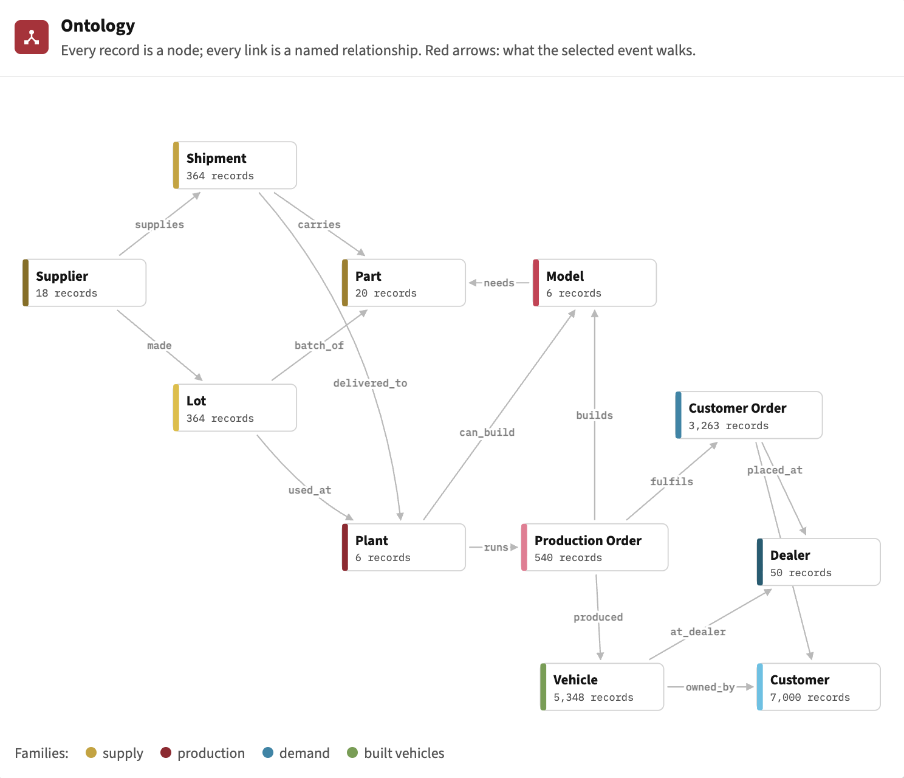
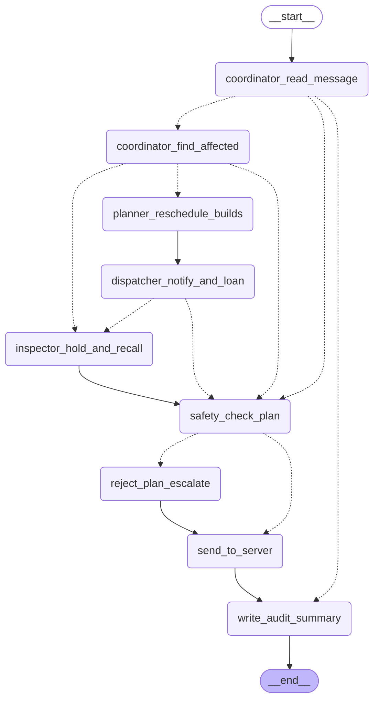

# 📦 SUBMISSION — Hack the Highway (Wacky Wheels Control Tower)

**Everything the judges asked for is in this folder.** Each numbered folder is one submission item.
All of it comes from a single **live run** of the 15 events in `data/events.json` against the organisers' `enterprise_server.py`, which was left unchanged.

**Model used:** Google `gemini-3.5-flash-lite` (temperature 0), with **15 LLM calls in total** (one per event). Everything after reading the message is deterministic Python. Source code is in the repo root; see the [main README](../README.md).

| # | Folder | What it is |
|---|---|---|
| 1 | [`1_ACTION_LOG/`](1_ACTION_LOG/) | **`action_log.jsonl`**: the graded log written by the enterprise server. 850 tool calls, **0 failed** |
| 2 | [`2_TRACES_one_per_event/`](2_TRACES_one_per_event/) | **`E-01.json` … `E-15.json`**: one reasoning trace per event (see below) |
| 3 | [`3_ONTOLOGY_and_KNOWLEDGE_GRAPH/`](3_ONTOLOGY_and_KNOWLEDGE_GRAPH/) | **`ontology.png`** (diagram), `ontology.mmd` / `.json` (11 node types, 16 relationships), and the **full knowledge graph** `knowledge_graph.graphml` / `.json` (16,979 nodes, 26,741 edges; opens in Gephi, Cytoscape or yEd) |
| 4 | [`4_GRAPH_PATH_DIAGRAMS/`](4_GRAPH_PATH_DIAGRAMS/) | Full graph paths for the compound event E-01, one diagram per incident, from the starting record to every affected customer |
| 5 | [`5_AGENT_WORKFLOW_DIAGRAM/`](5_AGENT_WORKFLOW_DIAGRAM/) | `agent_graph.mmd`: the LangGraph workflow, generated from the code (also drawn below) |
| 6 | [`6_POLICY_CHECKS/`](6_POLICY_CHECKS/) | `checks.json`: our independent checker re-derives the expected outcome from the raw CSVs. **15 / 15 events pass** |
| 7 | [`7_CONTROL_TOWER_snapshot/`](7_CONTROL_TOWER_snapshot/) | `control_tower.html`: the dashboard for this run as one self-contained file. **Download it and open it in a browser** (GitHub only shows the source) |

## Summary and reason per event

Each trace holds the raw message, how the LLM read it, the verdict and its reason, the graph path walked, every tool call with its rationale and the server's response, and a summary from each agent.

| Event | Category | Verdict | Tool calls | Failed | What the system did and why |
|---|---|---|---|---|---|
| [E-01](2_TRACES_one_per_event/E-01.json) | Plant outage + Supplier delay | ACT | 100 (81 write) | 0 | San Antonio (P_TX) is down Mar 19–22. Shipment SH-0190 of infotainment chip from Quanta Silicon to Princeton (P_IN) is late: due Mar 15, now arriving Mar 19. Rescheduled 8 production orders at Princeton (P_IN) for Mar 19–24; 6 at San Antonio (P_TX) for Mar 23–25. Notified 41 dealers about their 122 affected customer orders. Assigned loaners to 26 of 30 eligible Platinum/Gold customers; 4 missed out because their dealer's pool was empty. |
| [E-02](2_TRACES_one_per_event/E-02.json) | Unconfirmed report | ESCALATE | 1 (1 write) | 0 | Not actionable: report is unconfirmed or vague. Escalated to a human. |
| [E-03](2_TRACES_one_per_event/E-03.json) | Quality hold | ACT | 188 (188 write) | 0 | Lot LOT-0130 of infotainment chip from Kestrel Electronics is defective; it went into vehicles built at Jackson (P_MS) Feb 25–Mar 1. Put LOT-0130 on hold, stopped sale of 110 unsold vehicles at 37 dealers and contacted 150 owners of sold vehicles. |
| [E-04](2_TRACES_one_per_event/E-04.json) | Plant outage | ACT | 75 (59 write) | 0 | Lexington (P_KY) is down Mar 16–18. Rescheduled 9 production orders at Lexington (P_KY) for Mar 19–25. Notified 32 dealers about their 79 affected customer orders. Assigned loaners to 18 of 22 eligible Platinum/Gold customers; 4 missed out because their dealer's pool was empty. |
| [E-05](2_TRACES_one_per_event/E-05.json) | Noise | NO ACTION | 0 (0 write) | 0 | The message is not about operations: this is a question about a brochure and is completely unrelated to operations. No action taken. |
| [E-06](2_TRACES_one_per_event/E-06.json) | Noise | NO ACTION | 0 (0 write) | 0 | The message is not about operations: this message is about a dealer asking for a brochure and is not related to our operations. No action taken. |
| [E-07](2_TRACES_one_per_event/E-07.json) | Noise | NO ACTION | 0 (0 write) | 0 | The message is not about operations: this message is a routine dealer inquiry about a brochure and is completely unrelated to manufacturing operations. No action taken. |
| [E-08](2_TRACES_one_per_event/E-08.json) | Plant outage | ACT | 57 (46 write) | 0 | Lexington (P_KY) is down Mar 24–25. Rescheduled 6 production orders at Lexington (P_KY) for Mar 26–30. Notified 25 dealers about their 56 affected customer orders. Assigned loaners to 15 of 15 eligible Platinum/Gold customers. |
| [E-09](2_TRACES_one_per_event/E-09.json) | Supplier delay | ACT | 51 (42 write) | 0 | Shipment SH-0256 of surround-view camera kit from Orbit Optics to Huntsville (P_AL) is late: due Mar 29, now arriving Apr 1. Rescheduled 4 production orders at Huntsville (P_AL) for Apr 1–2; transferred 2 orders to another plant (PO-0442 to P_KY on Mar 8, PO-0444 to P_IN on Mar 8). Notified 26 dealers about their 54 affected customer orders. Assigned loaners to 10 of 12 eligible Platinum/Gold customers; 2 missed out because their dealer's pool was empty. |
| [E-10](2_TRACES_one_per_event/E-10.json) | Supplier delay | ACT | 35 (28 write) | 0 | Shipment SH-0248 of 60 kWh battery pack from Lumen Cells to Huntsville (P_AL) is late: due Mar 29, now arriving Apr 1. Rescheduled 3 production orders at Huntsville (P_AL) for Apr 1–2. Notified 18 dealers about their 29 affected customer orders. Assigned loaners to 7 of 7 eligible Platinum/Gold customers. |
| [E-11](2_TRACES_one_per_event/E-11.json) | Plant outage | ACT | 75 (62 write) | 0 | Jackson (P_MS) is down Mar 26–30. Rescheduled 6 production orders at Jackson (P_MS) for Mar 31–Apr 2; transferred 3 orders to another plant (PO-0259 to P_KY on Mar 8, PO-0260 to P_AL on Mar 8, PO-0261 to P_NC on Mar 8). Notified 36 dealers about their 79 affected customer orders. Assigned loaners to 17 of 18 eligible Platinum/Gold customers; 1 missed out because their dealer's pool was empty. |
| [E-12](2_TRACES_one_per_event/E-12.json) | Supplier delay | ACT | 34 (27 write) | 0 | Shipment SH-0182 of surround-view camera kit from Orbit Optics to Princeton (P_IN) is late: due Mar 15, now arriving Mar 18. Rescheduled 3 production orders at Princeton (P_IN) for Mar 18–19. Notified 14 dealers about their 26 affected customer orders. Assigned loaners to 10 of 10 eligible Platinum/Gold customers. |
| [E-13](2_TRACES_one_per_event/E-13.json) | Unconfirmed report | ESCALATE | 1 (1 write) | 0 | Not actionable: report is unconfirmed or vague. Escalated to a human. |
| [E-14](2_TRACES_one_per_event/E-14.json) | Quality hold | ACT | 131 (131 write) | 0 | Lot LOT-0017 of heavy-duty wiring harness from Atlas Wire and Cable is defective; it went into vehicles built at San Antonio (P_TX) Feb 22–24. Put LOT-0017 on hold, stopped sale of 86 unsold vehicles at 36 dealers and contacted 94 owners of sold vehicles. |
| [E-15](2_TRACES_one_per_event/E-15.json) | Quality hold | ACT | 102 (102 write) | 0 | Lot LOT-0191 of infotainment chip from Quanta Silicon is defective; it went into vehicles built at Princeton (P_IN) Mar 2–3. Put LOT-0191 on hold, stopped sale of 40 unsold vehicles at 25 dealers and contacted 76 owners of sold vehicles. |

**Verdicts:** **ACT** means a confirmed incident whose names, dates and records all check out against the data. **ESCALATE** covers a rumour or vague report, or anything that doesn't check out; it produces one `escalate` call and no operational change. **NO ACTION** means the message isn't about operations, so no tool calls are made.

## Graph paths by incident type

| Incident | Path walked in the knowledge graph |
|---|---|
| Supplier delay | Shipment ─carries→ Part ←needs─ Model ←builds─ Production Order ─fulfils→ Customer Order → Dealer / Customer |
| Plant outage | Plant ─runs→ Production Order ─fulfils→ Customer Order → Dealer / Customer |
| Quality hold | Lot ─batch_of→ Part ←needs─ Model ←builds─ Production Order ─produced→ Vehicle → Dealer / Customer |

## Agent workflow (LangGraph, generated from the code)

Coordinator: `coordinator_*`, `send_to_server`, `write_audit_summary` · Supply Chain Planner: `planner_*` · Customer Care Dispatcher: `dispatcher_*` · Quality Inspector: `inspector_*` · Guardrails: `safety_check_plan` (dry run of the whole plan) and `reject_plan_escalate`.
